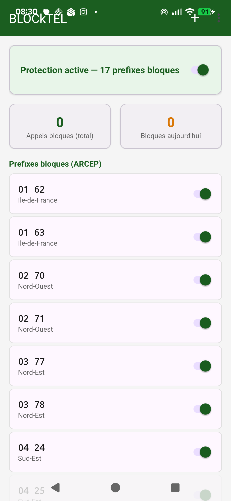
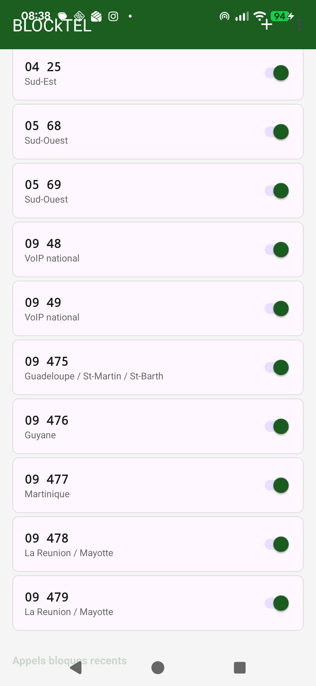

<p align="center">
  
  &nbsp;&nbsp;&nbsp;
  
</p>

<p align="center">
  <strong>Android call blocker for French telemarketing numbers</strong><br/>
  Automatically filters incoming calls from ARCEP-designated telemarketing prefixes in France.
</p>

<p align="center">
  <a href="#how-it-works">How it works</a> &bull;
  <a href="#blocked-prefixes">Prefixes</a> &bull;
  <a href="#install">Install</a> &bull;
  <a href="#build">Build</a> &bull;
  <a href="README.md">Francais</a>
</p>

---

# BLOCkTEL

## How it works

BLOCkTEL uses Android's `CallScreeningService` (Android 10+) to intercept every incoming call.
The phone number is normalized (handles `+33` / `0033` / `0` formats) then matched against active prefixes.
If the number starts with a telemarketing prefix, the call is silently rejected: no ring, no notification.

Blocked calls remain visible in the system call log (deliberate choice for transparency).

### Features

- 17 pre-configured ARCEP prefixes (12 metropolitan + 5 overseas)
- Individual toggle per prefix
- Custom prefix support
- Blocked call counter (total + today)
- History of the last 200 blocked calls
- Zero external dependencies (only AndroidX / Material)
- No data collection, everything stays on device

## Blocked prefixes

The prefixes below are officially assigned by ARCEP (French telecom authority) to telemarketing in France. All are enabled by default.

### Metropolitan France

| Prefix | Region |
|--------|--------|
| 01 62, 01 63 | Ile-de-France (Paris area) |
| 02 70, 02 71 | North-West |
| 03 77, 03 78 | North-East |
| 04 24, 04 25 | South-East |
| 05 68, 05 69 | South-West |
| 09 48, 09 49 | VoIP national |

### Overseas territories

| Prefix | Territory |
|--------|-----------|
| 09 475 | Guadeloupe / Saint-Martin / Saint-Barthelemy |
| 09 476 | French Guiana |
| 09 477 | Martinique |
| 09 478, 09 479 | Reunion / Mayotte |

## Install

### From GitHub releases

1. Download the latest APK from the [Releases](https://github.com/macaron-software/blocktel/releases/tag/v1.0) page or directly via [app-release.apk](https://github.com/macaron-software/blocktel/releases/download/v1.0/app-release.apk)
2. Install the APK on the phone (enable "Unknown sources" if needed)
3. Open BLOCkTEL and grant the call screening permission

### Via ADB

```bash
adb install app-release.apk
```

## Build

```bash
# Clone the repository
git clone https://github.com/macaron-software/blocktel.git
cd blocktel

# Debug build
./gradlew assembleDebug

# Install on connected device
./gradlew installDebug
```

**Requirements:** Android SDK, JDK 17+.
**Minimum:** Android 10 (API 29). **Target:** Android 15 (API 35).

## Permissions

| Permission | Purpose |
|-----------|---------|
| `BIND_SCREENING_SERVICE` | Allows the system to route incoming calls to the screening service |
| `READ_PHONE_STATE` | Read phone state |
| `READ_CALL_LOG` | Access call log |
| `RECEIVE_BOOT_COMPLETED` | Auto-restart after device reboot |

On first launch, Android will ask to authorize BLOCkTEL as a call screening service (`CALL_SCREENING` role).

## Architecture

```
com.macaron.blocktel/
  BlockTelApp.kt           Application (initialization)
  CallBlockerService.kt    CallScreeningService (blocking core)
  NumberNormalizer.kt       +33/0033/0 normalization
  PrefixRepository.kt      Rule storage (SharedPreferences)
  BlockedCallLog.kt        Blocked call history
  BootReceiver.kt          Restart after boot
  MainActivity.kt          User interface
  ui/
    PrefixAdapter.kt       Prefix list with toggles
    RecentCallsAdapter.kt  Recent blocked calls
```

## License

MIT - Macaron Software
